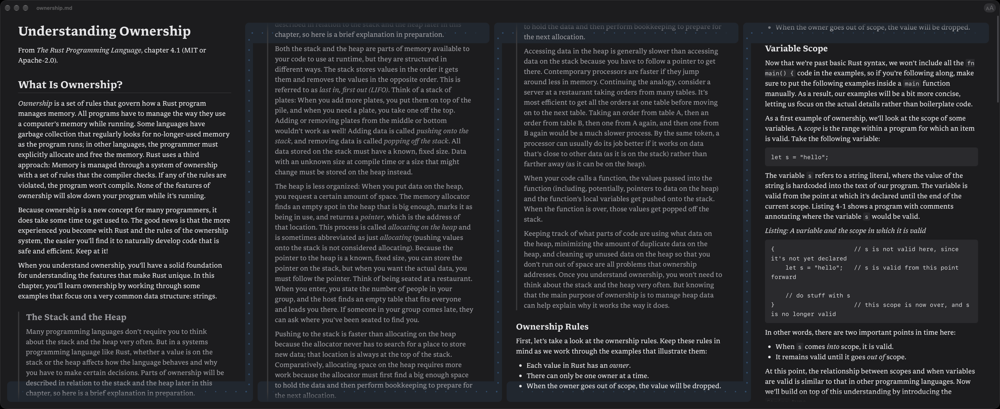
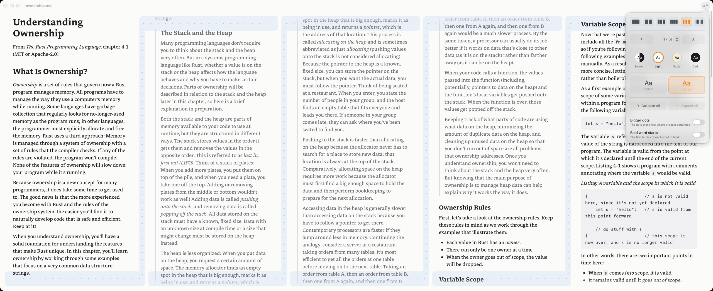

# Columns

**Lightweight Markdown reader for ultrawide screens.**



Columns opens a Markdown file and lays it out across your screen in side-by-side columns of text, so a long
document fills a wide monitor instead of one narrow strip down the middle. The text runs from the bottom of one
column to the top of the next, like a newspaper, and all the columns scroll together. A dotted ribbon joins the end
of each column to the top of the next, so your eye knows where to go.

It is a reader, not an editor: it never changes your files. When a file changes on disk (you, or an AI agent,
editing it in another app), Columns shows the new text at once and marks what changed.

## Features

- 1 to 6 columns (⌘1 … ⌘6); the default follows the width of your screen. A short document stands in the middle.
- Sections collapse at their headings; Go to Section lists the outline and marks where you are.
- Find (⌘F), with every match marked in every column. Back and Forward (⌘[ ⌘]) after a jump.
- Opens where you left off: the files you had open, at the line you were reading.
- Links to other Markdown files open them in Columns, at the heading they name.
- Themes: System, Light, Sepia, Dark. Fonts: System and Libron. Text size from 8 to 48 points.
- Bold word starts: the first letters of each word in bold, if that helps you read.
- Export as PDF and Print: one clean copy in pages, every section open.
- Columns itself sends nothing anywhere. (Pictures that a document links from the web load from there.)



## Install

Download `Columns-<version>.dmg` from [Releases](https://github.com/ojasviyadav/columns/releases), open it, and drag
Columns to Applications. The app is signed and notarized by Apple. Requires macOS 14.2 or later, on a Mac with Apple
silicon or Intel.

The first page it shows explains everything; it is always at **Help > Columns Help** (⌘?).

## Build from source

You need the Xcode command line tools (`xcode-select --install`).

```bash
./build.sh
```

This compiles the app with `swiftc` for Apple silicon and Intel, signs it ad hoc, and installs it in
`~/Applications/Columns.app`. `INSTALL=0 ./build.sh` only builds it, in `build/`.
`NOTARY_PROFILE=<profile> ./release.sh` makes the signed and notarized disk image of a release.

## How it is made

Two Swift files and one web page. `main.swift` is the AppKit app (windows, menus, find bar, watching the file),
`Settings.swift` the SwiftUI settings popover, and `Resources/index.html` the page in a `WKWebView` that lays the text
out: each column holds a copy of the document, moved so that column k starts where column k−1 ends. Markdown is
parsed by [marked](https://github.com/markedjs/marked). The icon is drawn by `icon/icon.swift`.

### States

The page (`Resources/index.html`) keeps each of its states under one name. A state changes only through `go(machine, state)`,
is written as `data-<machine>` on the element it styles, and is read from outside with `R.state()`.

| Machine | States | Meaning |
| --- | --- | --- |
| `page` | `empty`, `document`, `message` | What the page shows. A message stands in for a file that cannot be shown; input does not reach the text behind it. |
| `motion` | `still`, `opening`, `scrolling`, `gliding`, `dragging` | What moves the text. A new mover takes over from a glide at once. The ribbons glow in every state but `still`. |
| `layout` | `settled`, `folding`, `morphing` | The text being laid out anew. Morphs (columns, bold word starts, font) run one at a time; a later one waits. |
| `find` | `off`, `found`, `none` | The find in progress. |
| `pointer` | `resting`, `moving` | The pointer over the page; the section arrows show while it moves. |
| `fill` | `columns`, `single` | Whether the text fills the columns, or fits in one and stands in the middle. |

`R.state()` also gives `place` (`top`, `restored`, `pinned` or `part`: how the reading place is held through a new layout),
the number of columns, bold word starts, the matches, and the collapsed sections.

In the app (`main.swift`), `Reader.showing` is the one value for what a window shows of its file: `nothing`, `text`,
`lastVersion(why)`, `empty` or `problem(why)`. It is set only in `reload`; the banner and the menus follow it.

`checks/check-states.sh` walks the page through these states, and through keeping the reading place, in a check copy of
the app (`CHECK_COPY=1 ./build.sh`), and fails on a wrong one. `COLUMNS_DISPLAY="<display name>"` runs it on another display.

## Licences

Columns is under the MIT licence (`LICENSE`). The Libron font is under the SIL Open Font License
(`Resources/Libron-OFL.txt`). Markdown is parsed by [marked](https://github.com/markedjs/marked) (MIT). The text in the
screenshots is from [The Rust Programming Language](https://github.com/rust-lang/book) (MIT or Apache-2.0).
